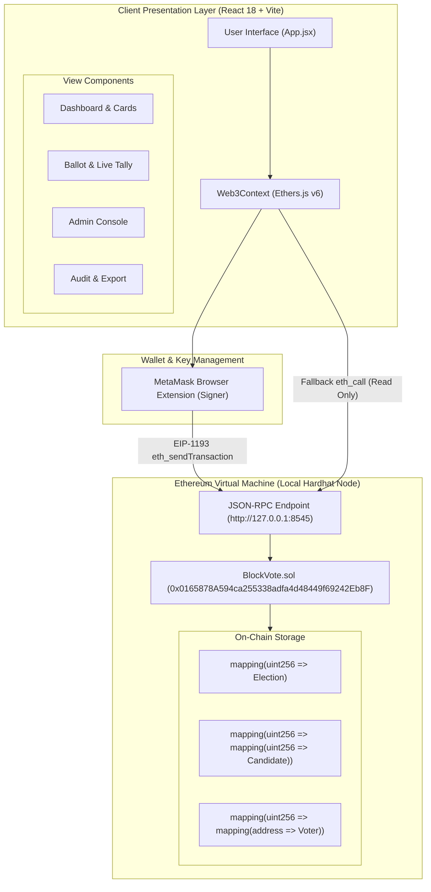
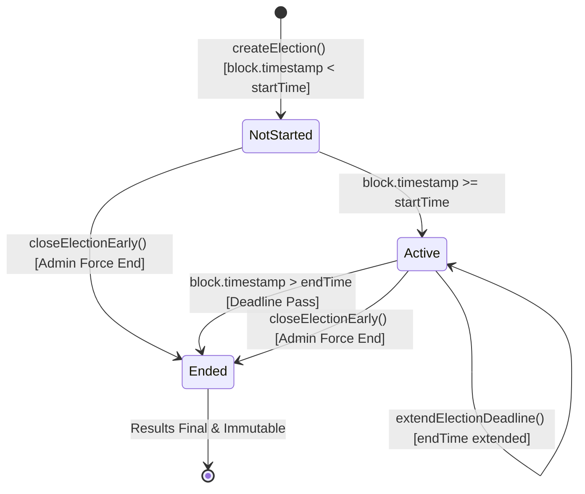

# 🏗️ BlockVote - Technical Architecture & Complete Specifications

This document provides in-depth technical specifications, data structure documentation, smart contract mechanics, and security analysis for the **BlockVote** decentralized voting system.

---

## 📑 Table of Contents
1. [System Architecture Diagram](#1-system-architecture-diagram)
2. [Smart Contract Technical Specification (`BlockVote.sol`)](#2-smart-contract-technical-specification)
3. [State Transition Model](#3-state-transition-model)
4. [Data Storage & Struct Definitions](#4-data-storage--struct-definitions)
5. [Interface & Function Signatures](#5-interface--function-signatures)
6. [Frontend State & Web3 Architecture](#6-frontend-state--web3-architecture)
7. [Automated Test Suite Specification](#7-automated-test-suite-specification)
8. [Security Threat Model & Academic Limitations](#8-security-threat-model--academic-limitations)

---

## 1. System Architecture Diagram



### Architectural Highlights
- **Decoupled Read/Write Paths:** If MetaMask is disconnected, the frontend creates a fallback read-only `ethers.JsonRpcProvider("http://127.0.0.1:8545")`. This guarantees visitors can browse elections and view live tallies without connecting a wallet.
- **Atomic State Transitions:** All voting transactions execute atomically. Either the vote increments and the voter is permanently marked as voted, or the EVM reverts the entire transaction with no state mutation.
- **Automated Artifact Pipeline:** Running [`scripts/deploy.js`](file:///e:/projects/blockchain%20based%20voting%20system/smart-contracts/scripts/deploy.js) automatically exports the deployed contract address and ABI directly into the frontend repository, preventing version divergence.

---

## 2. Smart Contract Technical Specification

- **File Path:** [`smart-contracts/contracts/BlockVote.sol`](file:///e:/projects/blockchain%20based%20voting%20system/smart-contracts/contracts/BlockVote.sol)
- **Solidity Version:** `pragma solidity ^0.8.24;`
- **Compiler Target:** `paris` (EVM compatible)
- **Hardhat Optimizer:** Enabled (`runs: 200`, `viaIR: true`)
- **Inheritance:**
  - `Ownable` (OpenZeppelin v5): Manages deployer ownership and administrator authorizations.
  - `ReentrancyGuard` (OpenZeppelin v5): Provides reentrancy protection on critical mutator functions.

---

## 3. State Transition Model

Each election follows a deterministic, timestamp-driven lifecycle represented by the `ElectionState` enum:



### Election State Determination
The contract calculates state dynamically via [`getElectionState(uint256 _electionId)`](file:///e:/projects/blockchain%20based%20voting%20system/smart-contracts/contracts/BlockVote.sol#L254):
```solidity
if (el.forceEnded || block.timestamp > el.endTime) {
    return ElectionState.Ended;
} else if (block.timestamp < el.startTime) {
    return ElectionState.NotStarted;
} else {
    return ElectionState.Active;
}
```

---

## 4. Data Storage & Struct Definitions

### 4.1 Structs

#### `Candidate`
Represents an individual or proposition running in an election:
```solidity
struct Candidate {
    uint256 id;          // 1-indexed sequential identifier
    string name;         // Candidate display name
    string party;        // Political party, manifesto, or platform
    string avatarUrl;    // Optional image URL
    uint256 voteCount;   // Cumulative ballots cast for this candidate
}
```

#### `Voter`
Tracks individual wallet participation per election:
```solidity
struct Voter {
    bool isRegistered;        // Whitelist authorization flag
    bool hasVoted;            // Duplicate vote prevention flag
    uint256 votedCandidateId; // Candidate ID chosen by the voter
    uint256 voteTimestamp;    // Block timestamp when ballot was accepted
}
```

#### `Election` (Internal Storage)
```solidity
struct Election {
    uint256 id;              // Sequential election index
    string title;            // Election title
    string description;      // Rules and context
    uint256 startTime;       // Unix epoch timestamp when voting begins
    uint256 endTime;         // Unix epoch deadline
    uint256 candidateCount;  // Number of registered candidates
    uint256 totalVotes;      // Total valid ballots cast
    bool exists;             // Existence validation flag
    bool forceEnded;         // Admin early termination flag
    address creator;         // Wallet that created the election
}
```

#### `ElectionView` (External ABI Optimization)
Solidity limits stack depth (16 slots). Unpacking tuples with multiple strings can produce `Stack too deep` errors. `ElectionView` is a memory-efficient struct designed for atomic frontend queries:
```solidity
struct ElectionView {
    uint256 id;
    string title;
    string description;
    uint256 startTime;
    uint256 endTime;
    uint256 candidateCount;
    uint256 totalVotes;
    ElectionState state;
    address creator;
}
```

---

## 5. Interface & Function Signatures

### 5.1 Mutator Functions (State-Changing)

| Function | Modifiers | Access | Description |
| :--- | :--- | :--- | :--- |
| `createElection(string _title, string _description, uint256 _startTime, uint256 _endTime)` | `onlyAdmin` | Admin | Deploys a new election. Validates title is not empty, `startTime < endTime`, and `endTime > block.timestamp`. |
| `addCandidate(uint256 _electionId, string _name, string _party, string _avatarUrl)` | `onlyAdmin`, `electionMustExist` | Admin | Adds a candidate. Validates election is not closed and candidate name is not empty. |
| `registerVoter(uint256 _electionId, address _voter)` | `onlyAdmin`, `electionMustExist` | Admin | Whitelists a single voter address. Rejects zero address and already-registered addresses. |
| `registerVotersBatch(uint256 _electionId, address[] _votersList)` | `onlyAdmin`, `electionMustExist` | Admin | Iterates through `_votersList` and whitelists each address. Skips duplicates. |
| `vote(uint256 _electionId, uint256 _candidateId)` | `nonReentrant`, `electionMustExist` | Whitelisted Voter | Validates election is active, voter is registered, voter has not voted, and candidate ID is valid. Increments candidate vote count and election total votes. |
| `closeElectionEarly(uint256 _electionId)` | `onlyAdmin`, `electionMustExist` | Admin | Sets `forceEnded = true`. Prohibits any further votes. |
| `extendElectionDeadline(uint256 _electionId, uint256 _newEndTime)` | `onlyAdmin`, `electionMustExist` | Admin | Extends `endTime`. Validates `newEndTime > currentEndTime` and `newEndTime > block.timestamp`. |

---

### 5.2 View Functions (Read-Only)

| Function | Return Type | Description |
| :--- | :--- | :--- |
| `getElection(uint256 _electionId)` | `ElectionView` | Returns full details, computed state, and totals for an election. |
| `getCandidates(uint256 _electionId)` | `Candidate[]` | Returns the array of all candidates and their live vote counts. |
| `getVoterStatus(uint256 _electionId, address _voter)` | `(bool, bool, uint256, uint256)` | Returns `(isRegistered, hasVoted, votedCandidateId, voteTimestamp)`. |
| `getAllElections()` | `ElectionView[]` | Returns summary list of all registered elections for the dashboard. |
| `academicDisclaimer()` | `string` | Returns the built-in transparency disclaimer string. |

---

### 5.3 On-Chain Events

```solidity
event ElectionCreated(uint256 indexed electionId, string title, uint256 startTime, uint256 endTime, address indexed creator);
event CandidateAdded(uint256 indexed electionId, uint256 indexed candidateId, string name, string party);
event VoterRegistered(uint256 indexed electionId, address indexed voter);
event VotersBatchRegistered(uint256 indexed electionId, uint256 count);
event VoteCast(uint256 indexed electionId, uint256 indexed candidateId, address indexed voter, uint256 timestamp);
event ElectionClosed(uint256 indexed electionId, uint256 closedAt);
event ElectionDeadlineExtended(uint256 indexed electionId, uint256 newEndTime);
```

---

## 6. Frontend State & Web3 Architecture

The React frontend utilizes **Ethers.js v6** encapsulated within a custom context provider:

### Core Modules:
1. **[`Web3Context.jsx`](file:///e:/projects/blockchain%20based%20voting%20system/frontend/src/context/Web3Context.jsx):**
   - Connects to `window.ethereum` using `ethers.BrowserProvider`.
   - Listens to EIP-1193 events: `accountsChanged` and `chainChanged`.
   - Detects when the user connects the owner wallet and activates `isAdmin = true`.
   - Provides `switchToHardhatNetwork()` via `wallet_switchEthereumChain` / `wallet_addEthereumChain`.
2. **[`helpers.js`](file:///e:/projects/blockchain%20based%20voting%20system/frontend/src/utils/helpers.js):**
   - [`parseContractError(err)`](file:///e:/projects/blockchain%20based%20voting%20system/frontend/src/utils/helpers.js#L68): Inspects revert codes and translates low-level EVM errors into clear English messages (e.g., *"Duplicate Vote Prevented"*, *"Voter Ineligible"*).
   - Dynamic countdown formatting with real-time ticker ticks.
3. **Optimistic UI vs. Blockchain Confirmation:**
   - Voting buttons transition into loading states during signature & block mining.
   - Upon receipt confirmation, the UI fires a full state re-fetch from the EVM and triggers `canvas-confetti`.

---

## 7. Automated Test Suite Specification

The contract undergoes 23 comprehensive unit tests across 5 domains in [`test/BlockVote.test.js`](file:///e:/projects/blockchain%20based%20voting%20system/smart-contracts/test/BlockVote.test.js):

| Test Category | Invariants Checked | Result |
| :--- | :--- | :--- |
| **Deployment & Configuration** | Owner assigned as admin; initial counter is 0; academic disclaimer validated; `setAdmin` permission restricted to `onlyOwner`. | ✅ Passed |
| **Election Creation** | Admin can create election; non-admin reverted; rejects empty title, invalid start/end timestamps, and past dates. | ✅ Passed |
| **Candidate Management** | Admin can add candidates; CandidateAdded event emitted; rejects empty names and non-existent election IDs. | ✅ Passed |
| **Voter Whitelisting** | Single voter registration; duplicate voter rejection; batch registration of 3+ addresses; non-admin rejection. | ✅ Passed |
| **Voting Mechanics** | Rejects voting before start time; valid vote succeeds; updates candidate vote count & election totals; **rejects duplicate votes from same wallet**; rejects unregistered addresses; rejects invalid candidate IDs; rejects voting after deadline. | ✅ Passed |
| **Lifecycle & Queries** | Admin can extend deadline; admin can close election early; subsequent votes rejected after close; `getAllElections()` returns complete list. | ✅ Passed |

---

## 8. Security Threat Model & Academic Limitations

### 8.1 Inherent Public Blockchain Limitations (Academic Disclosure)
- **Lack of Ballot Privacy:** In a standard EVM contract, state mappings and transaction parameters are public. An observer on the network can see that address `0x7099...` voted for Candidate #2.
- **Why this is an Academic Demo:** In national or enterprise elections requiring the Australian secret ballot standard, ballots must remain unlinkable to the voter's identity. Achieving this requires zero-knowledge cryptography (zk-SNARKs/zk-STARKs) or ring signatures, which are beyond the scope of a standard educational demonstration.

### 8.2 Addressed Vulnerabilities & Invariant Defenses

| Threat Vector | Defense Mechanism in BlockVote |
| :--- | :--- |
| **Sybil Attack (Fake Accounts)** | **Strict Whitelist:** Generating millions of Ethereum accounts does not grant voting power because only addresses registered in `voters[electionId][addr].isRegistered` can call `vote()`. |
| **Duplicate Voting** | **State Gate:** `require(!voters[electionId][msg.sender].hasVoted)` locks the address immediately upon the first transaction confirmation. |
| **Reentrancy Exploits** | **CEI & ReentrancyGuard:** State variables (`hasVoted = true`, `voteCount++`) are updated before events or external operations, and the `nonReentrant` modifier blocks re-entrant invocations. |
| **Late Ballot Injection** | **Timestamp Validation:** `require(block.timestamp <= el.endTime)` prevents votes from being mined once the deadline passes. |
| **Integer Overflows** | **Solidity 0.8+:** Native panic checks prevent arithmetic wrap-around. |
| **Miner Timestamp Manipulation** | Ethereum block timestamps can vary by ~12-15 seconds. For election deadlines spanning hours or days, a ~15-second variance poses zero practical security risk to election outcomes. |
