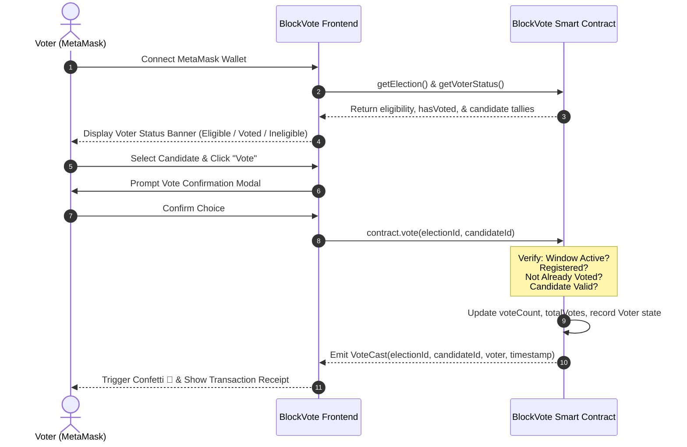

# 📖 BlockVote - Comprehensive User Manual

Welcome to the **BlockVote User Manual**. This guide provides end-to-end instructions for voters, election administrators, and academic auditors interacting with the BlockVote decentralized voting application.

---

## 📑 Table of Contents
1. [System Roles & Prerequisites](#1-system-roles--prerequisites)
2. [MetaMask Setup & Network Configuration](#2-metamask-setup--network-configuration)
3. [Voter User Guide (Casting Ballots)](#3-voter-user-guide-casting-ballots)
4. [Administrator User Guide (Election Management)](#4-administrator-user-guide-election-management)
5. [Auditor & Observer Guide (Verifying & Exporting Data)](#5-auditor--observer-guide-verifying--exporting-data)
6. [Troubleshooting & Common FAQs](#6-troubleshooting--common-faqs)

---

## 1. System Roles & Prerequisites

BlockVote establishes three primary personas:

| Persona | Capabilities | Typical Wallet |
| :--- | :--- | :--- |
| **Voter** | Connects wallet, verifies registration eligibility, casts one non-repeatable ballot per active election, views live tallies. | Hardhat Accounts #1, #2, #3, #4 |
| **Administrator** | Creates elections, configures start/end deadlines, registers candidates, whitelists eligible voters (single or batch), closes or extends elections. | Hardhat Account #0 (Deployer) |
| **Auditor / Observer** | Inspects contract state, views immutable tallies, exports JSON/CSV election records, verifies on-chain integrity. | Any wallet or read-only visitor |

### System Prerequisites
- Modern web browser: **Google Chrome**, **Brave**, **Microsoft Edge**, or **Mozilla Firefox**.
- **MetaMask** browser extension installed ([metamask.io](https://metamask.io/)).
- Local Hardhat node running on `http://127.0.0.1:8545`.
- BlockVote frontend accessible at `http://localhost:5174/` (or `http://localhost:5173/`).

---

## 2. MetaMask Setup & Network Configuration

Before interacting with the smart contract, your MetaMask wallet must be connected to the local Hardhat blockchain.

### Step 2.1: Add the Hardhat Localhost Network
1. Open the **MetaMask** extension popup.
2. Click the network dropdown selector in the top-left corner.
3. Click **Add Network** &rarr; **Add a network manually**.
4. Enter the following network parameters:
   - **Network Name:** `Hardhat Localhost`
   - **New RPC URL:** `http://127.0.0.1:8545`
   - **Chain ID:** `31337`
   - **Currency Symbol:** `ETH`
5. Click **Save** and select **Switch to Hardhat Localhost**.

> 💡 **Quick Switch Tip:** If you connect MetaMask on another network (e.g. Ethereum Mainnet or Sepolia), BlockVote will automatically display a red **"Switch to Localhost (31337)"** button in the top navigation bar. Clicking it prompts MetaMask to switch networks automatically!

---

### Step 2.2: Import Demo Accounts into MetaMask
BlockVote includes pre-funded accounts for instant local testing.

1. In the BlockVote web application, click the **"Test Accounts"** button in the top navigation bar.
2. A drawer will appear displaying the 6 pre-configured Hardhat test accounts:
   - **Admin / Deployer:** `0xf39Fd6e51aad88F6F4ce6aB8827279cffFb92266`  
     *Private Key:* `0xac0974bec39a17e36ba4a6b4d238ff944bacb478cbed5efcae784d7bf4f2ff80`
   - **Registered Voter #1:** `0x70997970C51812dc3A010C7d01b50e0d17dc79C8`  
     *Private Key:* `0x59c6995e998f97a5a0044966f0945389dc9e86dae88c7a8412f4603b6b78690d`
   - **Registered Voter #2:** `0x3C44CdDdB6a900fa2b585dd299e03d12FA4293BC`  
     *Private Key:* `0x5de4111afa1a4b94908f83103eb1f1706367c2e68ca870fc3fb9a804cdab365a`
   - **Unregistered Test Wallet:** `0x9965507D1a55bcC2695C58ba16FB37d819B0A4dc`  
     *Private Key:* `0x8b3a350cf5c34c9194ca85829a2df0ec3153be0318b5e2d3348e872092edffba`
3. Click the copy icon next to any account's **Private Key**.
4. In MetaMask, click your circular account avatar &rarr; **Add account or hardware wallet** &rarr; **Import account**.
5. Paste the private key and click **Import**.

---

## 3. Voter User Guide (Casting Ballots)

Follow these steps to inspect an election, verify your eligibility, and submit your vote.



### Step 3.1: Connect Your Wallet
1. Navigate to `http://localhost:5174/`.
2. Click the **"Connect MetaMask"** button in the upper right corner.
3. MetaMask will prompt you to authorize the connection. Select your desired test voter account (e.g., **Voter #1**).
4. Once connected, your truncated address (e.g. `0x7099...79C8`) and ETH balance will appear in the navbar.

---

### Step 3.2: Browse Elections on the Dashboard
1. On the **Elections Dashboard**, review the list of available elections.
2. Use the status filter tabs to switch between:
   - **All:** Displays every election recorded on the smart contract.
   - **Active:** Elections currently open for voting with active countdown timers.
   - **Upcoming:** Scheduled elections that have not yet reached their start timestamp.
   - **Concluded:** Elections where the deadline has passed or which were closed early.
3. Use the search bar to find an election by title (e.g., *"Presidential"* or *"Faculty"*).
4. Click **"Enter Ballot & Vote"** on any active election card.

---

### Step 3.3: Verify Your Eligibility Status
Inside the election view, look at the **Voter Voting Status** banner:
- 🟢 **Eligible & Registered:** Your wallet is registered by the admin. You are authorized to cast a vote.
- 🔴 **Not Registered:** Your address is not whitelisted for this election. The "Vote" buttons will be disabled.
- 🔵 **Vote Recorded on Ethereum:** You have already voted in this election. The banner shows the exact candidate you voted for and your transaction timestamp.

---

### Step 3.4: Select a Candidate and Submit Your Ballot
1. Review the candidate cards displaying each candidate's name, party/slogan, and current live vote share.
2. Click the **"Vote"** button on your preferred candidate.
3. A **Confirm Your Vote** modal will appear with:
   - Selected candidate name and party affiliation.
   - Your voter address.
   - Security reminder: *Votes cannot be changed or resubmitted once confirmed.*
4. Click **"Submit Vote"**.
5. MetaMask will pop up requesting your signature and standard gas confirmation. Click **Confirm**.
6. When the block confirms:
   - A celebration of animated confetti will trigger on your screen!
   - A green receipt box will display your transaction hash.
   - The candidate's vote counter and percentage bar will immediately increment.

---

### Step 3.5: Testing Duplicate Vote Prevention
To verify the smart contract's duplicate vote rejection:
1. Attempt to click **"Vote"** on another candidate in the same election.
2. The UI will prevent action because your status is now marked **"Ballot Cast"**.
3. If a user bypasses the UI and invokes the contract directly, the EVM transaction will revert with:
   ```
   "BlockVote: Duplicate voting is not permitted. You have already voted."
   ```

---

## 4. Administrator User Guide (Election Management)

Only the contract deployer (or wallets assigned via `setAdmin`) can access the administrative functions.

### Step 4.1: Connect as Administrator
1. Switch your MetaMask account to **Account #0** (`0xf39Fd6e51aad88F6F4ce6aB8827279cffFb92266`).
2. The navbar will display a magenta **`ADMIN`** badge.
3. Click the **"Admin Console"** tab in the navigation bar.

---

### Step 4.2: Sub-Tab 1 - Create an Election
1. Enter the **Election Title** (e.g., *"Campus Sports Council President 2026"*).
2. Enter the **Description** explaining voting rules and requirements.
3. Set the **Start Time** and **End Time (Deadline)**:
   - Use the datetime picker, OR
   - Click one of the **Quick Presets** (*1 Hour Demo*, *24 Hours*, or *7 Days*) to automatically compute timestamps.
4. Click **"Deploy Election on Chain"**.
5. Confirm the transaction in MetaMask. Upon confirmation, a new election ID is generated.

---

### Step 4.3: Sub-Tab 2 - Add Candidates
1. In the **Target Election** dropdown, choose the election you just created.
2. Enter the **Candidate Name / Option** (e.g., *"Jordan Lee"*).
3. Enter the **Party / Manifesto Slogan** (e.g., *"Athletics & Student Wellness Initiative"*).
4. *(Optional)* Enter an **Avatar Image URL** (e.g., an Unsplash photo link).
5. Click **"Add Candidate"** and confirm in MetaMask.
6. Repeat this process for all competing candidates or ballot propositions.

---

### Step 4.4: Sub-Tab 3 - Whitelist Eligible Voters

#### Method A: Batch Voter Registration (Recommended)
1. Select the **Target Election**.
2. In the textarea, input Ethereum addresses separated by commas or new lines.
3. Click **"Pre-fill 6 Local Hardhat Accounts"** to automatically populate all standard test accounts.
4. Click **"Batch Register Voters"** and approve the transaction in MetaMask.
5. All provided addresses are registered in a single gas-efficient transaction.

#### Method B: Single Voter Registration
1. In the **Register Single Voter** section, paste an individual wallet address.
2. Click **"Register Address"** and confirm.

---

### Step 4.5: Sub-Tab 4 - Lifecycle & Deadline Control
1. Select the active election.
2. **Extend Deadline:** If participation is low, choose `+1 Hour`, `+1 Day`, or `+7 Days`, then click **"Apply Deadline Extension"**.
3. **Early Termination:** If the voting period must end immediately, click **"Conclude Election Early"**. The smart contract marks `forceEnded = true`, locking all results permanently.

---

## 5. Auditor & Observer Guide (Verifying & Exporting Data)

Academic reviewers and election auditors can independently verify on-chain state without needing an admin wallet.

### Step 5.1: Audit Dashboard
Click on the **"Audit & Proofs"** tab in the top navigation bar.

1. **Verify Contract Address:** Displays the active deployed address (`0x0165...Eb8F`) and network chain ID (`31337`).
2. **Bytecode Invariants:** Details how the EVM enforces non-repudiation, reentrancy resistance, and timestamp barriers.
3. **On-Chain Election Registry:** A tabular breakdown of all created elections, candidate tallies, turnout percentages, and exact deadlines.

---

### Step 5.2: Exporting Election Data
At the top right of the Registry table, click either:
- **"Export JSON"**: Generates a structured JSON file containing all election metadata, candidate counts, and verified states.
- **"Export CSV"**: Generates a standard spreadsheet-compatible CSV file ideal for grading, research reports, or statistical analysis.

---

## 6. Troubleshooting & Common FAQs

### Issue 1: "Nonce too high" or "Internal JSON-RPC error" in MetaMask
**Cause:** When the local Hardhat node is restarted, its internal transaction counter (nonce) resets to 0, while MetaMask remembers transactions from previous sessions.  
**Solution:**
1. In MetaMask, click your circular avatar &rarr; **Settings** &rarr; **Advanced**.
2. Click **"Clear activity and nonce data"** (or **"Reset Account"**).
3. This resets MetaMask's transaction cache without losing your keys or funds.

---

### Issue 2: "Wrong Network" Warning Banner
**Cause:** MetaMask is connected to Ethereum Mainnet, Sepolia, or another testnet instead of Hardhat Localhost.  
**Solution:**
Click the red **"Switch to Localhost (31337)"** button in the top navigation bar, and confirm the switch prompt inside MetaMask.

---

### Issue 3: "BlockVote: You are not registered to vote in this election"
**Cause:** Your connected wallet address was not added to the election whitelist by the admin.  
**Solution:**
1. Switch to the Admin account (`0xf39Fd6e51aad88F6F4ce6aB8827279cffFb92266`).
2. Go to **Admin Console** &rarr; **Register Voters**.
3. Select the election, enter your wallet address, and click **Register Address**.
4. Switch back to your voter account; you can now vote!

---

### Issue 4: "BlockVote: Duplicate voting is not permitted"
**Cause:** You are attempting to cast a second ballot from the same wallet in the same election.  
**Solution:**
Smart contract rules strictly enforce one ballot per wallet per election. To test voting again, switch to a different registered test account (e.g., **Voter #2** or **Voter #4**) via the **Test Accounts** menu.
